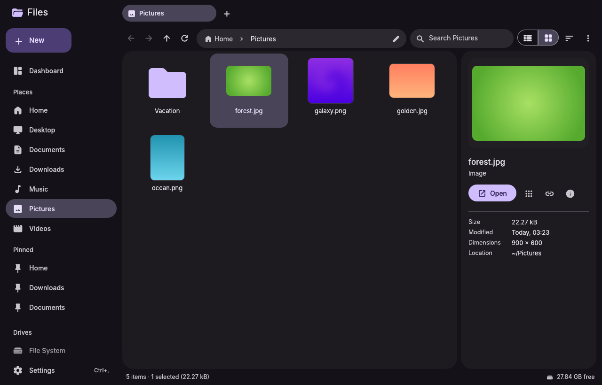
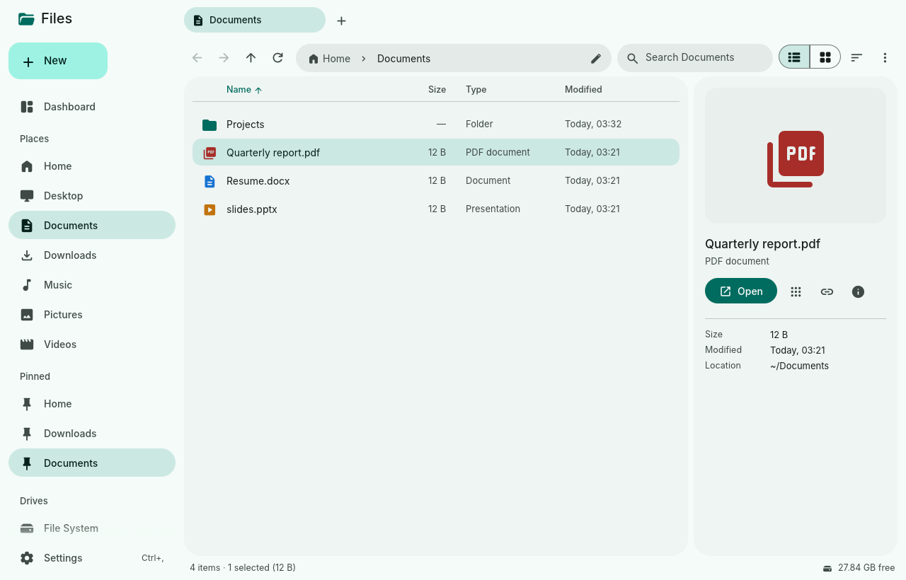

# Material 3 File Manager

A fast, keyboard-friendly Linux file manager built with [egui](https://github.com/emilk/egui) and themed with Material You. The palette comes from a seed color or from your wallpaper via [matugen](https://github.com/InioX/matugen).




## Features

**Browsing**
- Tabs (Ctrl+T / Ctrl+W, middle-click to close, drop files on a tab to move them there)
- Back/forward/up history. Going back re-selects the folder you came from.
- Breadcrumb path bar. Long paths collapse into a `…` menu. Click it or press Ctrl+L to type a path, with Tab completion and `~` expansion.
- Grid and list views. Sortable columns, natural sorting (`file2` before `file10`), optional "folders first".
- Group by type, with collapsible sections. The categories are editable in Settings.
- Image thumbnails, decoded in the background and cached on disk for large images. EXIF orientation is respected.
- Details pane (F9) with a large preview, metadata, image dimensions and a text preview.
- Grid size adjustable with Ctrl+scroll or Ctrl+= / Ctrl+-.
- Folders refresh live when their contents change.

**Search**
- Typing in the search box filters the current folder instantly.
- "Include subfolders" and "Search file contents" chips. Results stream in while the search runs, with a relative path shown for each result.

**Selection and keyboard**
- Click, Ctrl+click, Shift+click, rubber-band drag, Ctrl+A
- Arrow keys, Home/End and PageUp/PageDown. Shift extends the selection.
- Type a name to jump to it.
- F1 shows every shortcut.

**File operations**
- Copy, cut and paste (Ctrl+C/X/V). Paths also go to the system clipboard. Pasting paths or `file://` URIs copied from other apps works too.
- Drag and drop onto folders, tabs, breadcrumb segments and sidebar entries. Hold Ctrl to copy. Files dropped in from other apps are copied in.
- Move to… and Copy to… with a folder picker
- Move to trash with **Undo**, or delete permanently after a confirmation
- Inline rename (F2). The name is pre-selected without its extension, and invalid names or clashes are reported inline.
- New folder and new empty file
- Long operations run in the background, with a progress bar and a cancel button in the status bar. Name clashes become `name (copy).ext` instead of overwriting anything.

**Desktop integration**
- Open with the default app, or with a searchable "Open with" dialog. Apps that handle the file's type are listed first, and app icons come from your icon theme. Commands run without a shell.
- Open in terminal: your configured terminal, then common fallbacks. Open in editor.
- Optional `dms open` (DankMaterialShell) support
- Places (XDG user dirs), pinned folders and drives with usage bars in the sidebar
- A dashboard with storage, pinned and recent folders
- `m3fm --portal` serves `org.freedesktop.impl.portal.FileChooser`, so other apps' Open and Save dialogs use this file manager. Multiple selection, folder mode, filters, current folder and overwrite confirmation are supported.

**Google Drive**
- Connect from the sidebar, the dashboard or Settings → Cloud storage. You sign in with Google in your browser, and Drive is then mounted at `~/GoogleDrive` and shown under **Cloud** in the sidebar, with your storage quota.
- Everything else works there too: browsing, search, copy/move, drag and drop, rename, and Open with.
- Deleting a file on Drive moves it to Google Drive's own trash.
- Grid thumbnails and file-content search are turned off on Drive, so browsing doesn't download your files.
- Mount and unmount from the sidebar's right-click menu. Drive can mount automatically at startup, and you can choose another mount folder or connect more accounts. If rclone already has a signed-in Drive remote, it is reused instead of signing in again.
- Requires [rclone](https://rclone.org/install/) and FUSE 3 (`fusermount3`). The mount is an `rclone mount --vfs-cache-mode full` that keeps running after the app closes, until you unmount or log out.

## Install

From the AUR, prebuilt or built from source:

```sh
paru -S material-3-file-manager-bin   # or material-3-file-manager-git
```

On Arch, with the included PKGBUILD:

```sh
cd packaging
makepkg -si
```

Prebuilt x86_64 binaries are attached to [releases](https://github.com/bhimio1/material-3-file-manager-rust/releases). The end4-pC fork installs the latest one automatically.

To build it yourself:

```sh
cargo build --release
./target/release/m3fm [FOLDER]
```

Runtime requirements on Linux: an OpenGL driver, `libxkbcommon` (plus `libxkbcommon-x11` on X11) and, for Wayland, `libwayland-client`. These are present on any normal desktop.

## Configuration

Settings are edited in the app (Ctrl+,) and stored in `~/.config/m3fm/config.toml`. The file is watched: edits made by hand apply immediately. Config files from the earlier gpui build load unchanged.

### Theming

On an end4-pC or illogical-impulse desktop, nothing needs setting up: see the order below. Otherwise, use matugen:

1. In Settings → Matugen, click **Export template**.
2. Add the snippet shown there to `~/.config/matugen/config.toml`.
3. Run matugen. The app picks up `~/.config/material_3_file_manager/theme.json` live.

With the color source on **Auto**, the palette comes from, in order:

1. the end4-pC / illogical-impulse shell's `~/.local/state/quickshell/user/generated/colors.json`, so the file manager always matches the shell and follows wallpaper changes live;
2. matugen's `theme.json`, set up as above;
3. the seed color, in light, dark or system mode.

## Project layout

```
src/
  app.rs        app state, layout, shortcuts, action dispatch
  tab.rs        per-tab state: history, listing, search, selection
  config.rs     config.toml model
  thumbs.rs     background thumbnail/icon loading
  cloud.rs      Google Drive connect/mount state (rclone)
  fs/           listing & search, file jobs, watcher, apps, places, portal,
                rclone wrapper (cloud.rs)
  theme/        M3 palette (seed / matugen) → egui style
  ui/           sidebar, tabs, toolbar, file view, details, dashboard,
                settings, dialogs, toasts, M3 widgets
```

Run the tests with `cargo test`. Set `M3FM_PERF=1` to print per-second frame timings, the top repaint causes, and the cost of directory listings to stderr.

## License

MIT, see [LICENSE](LICENSE).

Fonts: Inter (SIL OFL 1.1, see `assets/fonts/LICENSE-Inter.txt`). Icons: Material Symbols, via `egui_material_icons`.
